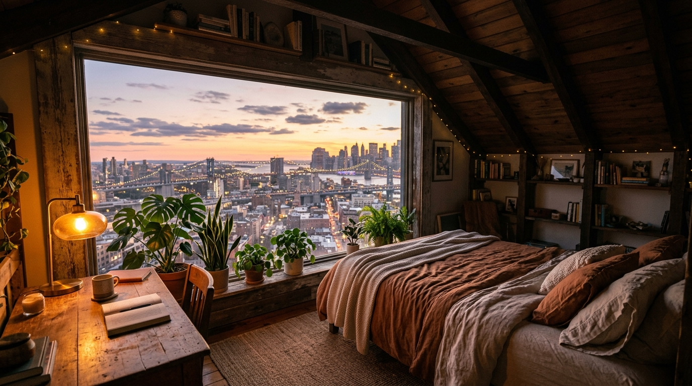

# 🌌 Wallora — AI-Enhanced Wallpaper Platform

A modern, high-performance web platform built with **Next.js 16**, **Tailwind CSS v4**, and **Framer Motion** for discovering, customizing, and downloading ultra high-resolution AI-enhanced wallpapers for mobile devices, laptops, desktops, and ultrawide monitors.



---

## ✨ Features & Capabilities

- **🎨 Luxury Obsidian Aesthetic**: Designed with an ultra-deep dark theme, glassmorphism (`backdrop-blur-xl`), glowing neon borders, and elegant editorial serif typography (**Playfair Display** & **Plus Jakarta Sans**).
- **🧭 Dedicated Multi-Page Navigation**:
  - **Home (`/`)**: Hero carousel slider, visual category chips, trending and recently added 6-card grids, curated collection highlights.
  - **Explore (`/explore`)**: Infinite discovery gallery with live multi-device filtering (Desktop 16:9, Mobile 9:16, Ultrawide 21:9), resolution selectors (8K, 4K, OLED), and sorting.
  - **Collections (`/collections`)**: Themed aesthetic packs (*Cyberpunk Tokyo 2099, Lo-Fi Dusk Havens, OLED Pure Blacks, Alpine Nature, Retro Automotive, Deep Cosmos*) with pack explorer views.
  - **Creators (`/creators`)**: Creative community directory with verified badges, follower counts, download stats, 3-thumbnail showcase strips, interactive follow buttons, and creator application modal.
  - **About (`/about`)**: Technical deep-dive on sub-pixel 8K neural upscaling, OLED true-black (#000000) calibration, hardware compatibility matrix (Apple Studio Display, MacBook Liquid Retina, Samsung Odyssey, iPhone 16 Pro), and interactive FAQ.
- **📱 Device Mockup Studio Simulator**: Preview any wallpaper live inside interactive CSS device frames:
  - **MacBook Pro** (with notch, menu bar, and macOS dock)
  - **iPhone 16 Pro** (with Dynamic Island, clock, and status bar)
  - **Studio Display Desktop** (with aluminum stand)
- **⚡ 1-Click Resolution Downloader**: Real client-side canvas engine capable of rendering and downloading in:
  - **8K Ultra HD** (7680 × 4320)
  - **4K UHD** (3840 × 2160)
  - **Mobile 9:16** (1170 × 2532)
  - **Ultrawide 21:9** (3440 × 1440)
  - Celebratory `canvas-confetti` micro-animation on download.
- **🏷️ Visual Category Chips**: Interactive category filter bar featuring 100% locally rendered thumbnail previews for *Nature, Aesthetic, Anime, Minimal, Dark / OLED, City, Space, Animals, Cars, Games, and Art*.
- **🔍 Instant Search & Quick Suggestions**: Autocomplete search with `⌘K` keyboard shortcut support across all pages.
- **🎨 Color Palette Extractor**: Extracts dominant 5-color hex swatches with 1-click clipboard copying.
- **🤖 AI Prompt Inspector & Studio**: Inspect prompts, generation models, and upscale parameters. Includes an interactive AI Studio for neural enhancement and OLED black calibration.
- **💾 LocalStorage Favorites**: Save wallpapers to favorites with a persistent counter badge and dedicated drawer.
- **📤 Community Upload**: Upload and publish custom wallpapers directly to the gallery during the session.

---

## 🖼️ Included 8K Ultra-HD Wallpapers

| Preview | Title | Category | Resolution |
| :--- | :--- | :--- | :--- |
| `hero_sunset_room.jpg` | Skyline Loft Sunset Panorama | City / Lo-Fi | 8K UHD |
| `bioluminescent_jellyfish.jpg` | Abyssal Bioluminescent Jellyfish | Dark / OLED | 8K UHD |
| `mountain_lake.jpg` | Alpine Mirror Lake & Peak | Nature | 4K UHD |
| `mech_warrior_neon.jpg` | Hangar Mech Sentinel EX-4 | Games / Sci-Fi | 8K UHD |
| `night_city_crescent.jpg` | Crescent Moon Nocturne | Dark / OLED | 4K UHD |
| `abstract_prismatic_glass.jpg` | Prismatic Zero-G Spheres | Art / 3D Abstract | 8K UHD |
| `cherry_blossom_street.jpg` | Kyoto Twilight Blossom Street | City / Japan | 4K UHD |
| `foggy_mountain_highway.jpg` | Cascade Highway Misty Pines | Nature | 8K UHD |
| `vintage_porsche_rain.jpg` | 1989 Porsche 911 Turbo Neon Rain | Cars | 8K UHD |
| `snow_leopard_blizzard.jpg` | Himalayan Snow Leopard Blizzard | Animals | 8K UHD |
| `anime_celestial_lanterns.jpg` | Celestial Maiden of the Torii Shrine | Anime / Fantasy | 8K UHD |
| `rainy_cafe_window.jpg` | Rainy Afternoon Window & Coffee | Aesthetic / Lo-Fi | 8K UHD |
| `pillars_of_creation_gold.jpg` | Pillars of Creation Infrared Gold | Space / Cosmos | 8K UHD |
| `cyberpunk_anime.jpg` | Tokyo 2099 Cyber Runner | Anime / Cyberpunk | 8K UHD |
| `black_supercar.jpg` | Obsidian McLaren Rain Asphalt | Cars / Supercars | 8K UHD |
| `tulips_sunlight.jpg` | Minimal Sunlit White Tulips | Aesthetic / Minimal | 4K UHD |
| `phone_cyberpunk_neon.jpg` | Neo Shinjuku Lockscreen Neon | Mobile Lockscreen | 4K UHD |

---

## 🛠️ Tech Stack

- **Framework**: [Next.js 16](https://nextjs.org/) (App Router, Turbopack)
- **Language**: TypeScript
- **Styling**: [Tailwind CSS v4](https://tailwindcss.com/)
- **Animations & Micro-interactions**: [Framer Motion](https://www.framer.com/motion/), [Canvas Confetti](https://www.npmjs.com/package/canvas-confetti)
- **Icons**: [Lucide React](https://lucide.dev/)
- **Fonts**: [Google Fonts](https://fonts.google.com/) via `next/font` (Playfair Display & Plus Jakarta Sans)

---

## 🚀 Getting Started

### 1. Clone the repository
```bash
git clone https://github.com/Mahima-1008/wallora.git
cd wallora
```

### 2. Install dependencies
```bash
npm install
```

### 3. Run the development server
```bash
npm run dev
```

Open [http://localhost:3000](http://localhost:3000) with your browser to experience the platform.

### 4. Build for production
```bash
npm run build
npm run start
```

---

## 📄 License

MIT License. Free for personal and commercial wallpaper usage.
